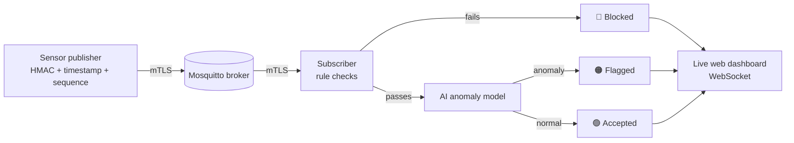

# Secure IoT Water Monitoring Pipeline

A secure MQTT pipeline for a simulated hotel water-monitoring system, built incrementally over eight weeks. It starts as plaintext, unauthenticated sensor traffic and ends as a layered defense that combines encryption, device identity, message authentication, replay protection and AI anomaly detection, with a live dashboard and tools to attack it.

> **Context:** externship project, with a simulated hotel ("Grand Marina") and simulated sensor data. No real client data is used.
> <!-- TODO: confirm with your externship supervisor that publishing the project name/branding is OK. -->

## Architecture



## Defense layers

| Layer | Introduced | Stops |
|-------|-----------|-------|
| TLS encryption | Week 4 | Eavesdropping, broker impersonation |
| Mutual TLS | Week 5 | Rogue devices with no certificate |
| HMAC signature | Week 6 | Message tampering |
| Timestamp window | Week 6 | Delayed replay |
| Sequence counter | Week 6 | Fast duplicate replay |
| AI anomaly detection | Week 8 | Validly signed but abnormal readings from an insider |

## Highlight: no single defense is enough

Replay-attack rejection rates from the week 6 experiments:

| Defense | Immediate replay | Delayed replay | Modified replay |
|---------|:---:|:---:|:---:|
| None | 0% | 0% | 0% |
| Timestamp only | 0% | 100% | 0% |
| Sequence counter only | 100% | 100% | 0% |
| **All three** | **100%** | **100%** | **100%** |


Week 8 then shows what even all three can't catch: an insider with a valid key who sends abnormal values, flagged orange by the AI layer.

> 📸 *Add a dashboard screenshot or GIF here showing green, red and orange events.*

## Project timeline

| Week | Topic | Folder |
|------|-------|--------|
| 1 | [Getting started] | [`week-1-getting-started`](week-1-getting-started) |
| 2 | [MQTT basics] | [`week-2-mqtt-basics`](week-2-mqtt-basics) |
| 3 | Insecure baseline: plaintext sensor and console dashboard | [`week-3-insecure-baseline`](week-3-insecure-baseline) |
| 4 | TLS encryption and performance tests | [`week-4-tls`](week-4-tls) |
| 5 | Mutual TLS and device certificates | [`week-5-mtls`](week-5-mtls) |
| 6 | Replay attack and defenses (HMAC, timestamp, sequence) | [`week-6-replay-defense`](week-6-replay-defense) |
| 7 | Live security dashboard and attack simulator | [`week-7-dashboard`](week-7-dashboard) |
| 8 | AI anomaly detection (Isolation Forest) | [`week-8-ai-detection`](week-8-ai-detection) |

## Quick start (full final system)

**Requirements:** Python 3.10+, [Mosquitto](https://mosquitto.org/), and

```bash
pip install paho-mqtt cryptography websockets numpy scikit-learn joblib matplotlib
```

Run everything **from the repository root**, since scripts expect `certs/` there.

```bash
# 1. Generate certificates (CA, server, device-001..003)
python week-5-mtls/generate_client_certs.py

# 2. Start the broker
mosquitto -c week-5-mtls/mosquitto_mtls.conf -v

# 3. Start the AI-enhanced dashboard (opens http://localhost:8000)
python week-8-ai-detection/subscriber_dashboard_ai.py

# 4. Normal traffic (green)
python week-6-replay-defense/publisher_defended.py

# 5. Subtle anomalies (orange)
python week-8-ai-detection/anomaly_injector.py

# 6. Rule-based attacks (red)
python week-7-dashboard/attack_simulator.py
```

Each week folder has its own README with the commands for that stage.

## Repository structure

```
.
├── README.md
├── requirements.txt
├── .gitignore                 # certs/*.pem, __pycache__/, .env
├── docs/
│   ├── architecture.png
│   ├── threat-model.md
│   └── screenshots/
├── week-1-getting-started/
├── week-2-mqtt-basics/
├── week-3-insecure-baseline/
├── week-4-tls/
├── week-5-mtls/
├── week-6-replay-defense/
├── week-7-dashboard/
└── week-8-ai-detection/
```

## Security notes

- **No keys or secrets are committed.** `certs/` is generated locally and gitignored.
- The HMAC key comes from the `SHARED_SECRET` environment variable; the default is a demo value for local testing only.
- This is a learning and demonstration project, not production-ready software.

## Known limitations and future work

- Sequence counters live in memory and reset on restart. Persist them.
- The HMAC key is shared and symmetric. Use per-device keys or asymmetric signatures.
- No topic ACLs, so any valid certificate can publish to any topic. Add a Mosquitto `acl_file` binding each certificate CN to its own topic.
- The AI model is per-message and trained on simulated data. A rolling-window model would also catch stuck sensors.

## Tech stack

Python · paho-mqtt · Mosquitto · TLS/mTLS (X.509 via `cryptography`) · HMAC-SHA256 · scikit-learn (Isolation Forest) · WebSockets · HTML/CSS/JS

## Author

**Min Thant Tun**, Junior Security Engineer, Hydroficient externship
