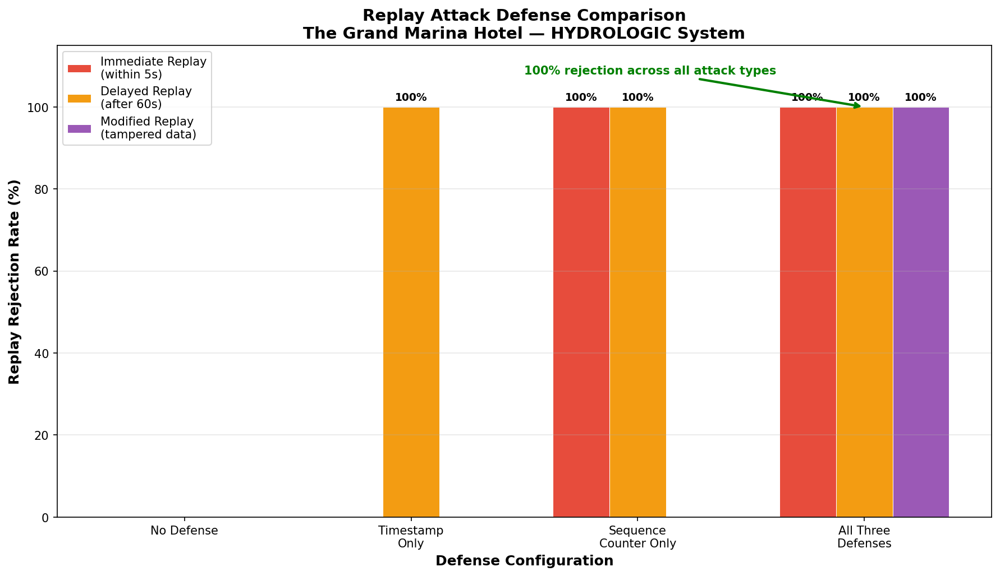

# Weeks 5-7 — Secure Pipeline: mTLS, Replay Defense and Live Dashboard

These three weeks turn the TLS-only pipeline from week 4 into a layered, observable defense. Each week follows the same pattern: **an attack, then the defense that stops it.**

| Week | Attack | Defense | Tool that proves it |
|------|--------|---------|---------------------|
| 5 | Rogue device with no / wrong / expired certificate | **Mutual TLS** | `identity_tester.py` |
| 6 | Insider replays or tampers with captured messages | **HMAC + timestamp + sequence counter** | `defense_tester.py`, `replay_attacker.py` |
| 7 | Forged and replayed messages against the live system | Same defenses, now **visible in real time** | `attack_simulator.py` + dashboard |

**Contents:** [Files](#files) · [Quick start](#quick-start) · [Week 5](#week-5--mutual-tls) · [Week 6](#week-6--replay-attack-defense) · [Week 7](#week-7--live-security-dashboard) · [Limitations](#known-limitations)

---

## Files

| File | Week | Purpose |
|------|:----:|---------|
| `generate_client_certs.py` | 5 | Creates CA, server cert and device certs (001-003) |
| `generate_test_certs.py` | 5 | Creates wrong-CA and expired certs for identity tests *(to be added)* |
| `mosquitto_mtls.conf` | 5 | mTLS broker on port 8883 |
| `mosquitto_mtls_8884.conf` | 5 | Second mTLS broker on 8884 for the benchmark *(to be added)* |
| `publisher_mtls.py` | 5 | Device publisher with client certificate |
| `subscriber_mtls.py` | 5 | Subscriber with client certificate |
| `identity_tester.py` | 5 | Simulates identity attacks (valid, no cert, wrong CA, expired) |
| `mtls_benchmark.py` | 5 | Measures mTLS vs one-way TLS overhead |
| `publisher_defended.py` | 6 | Publisher adding sequence number, timestamp and HMAC |
| `subscriber_defended.py` | 6 | Subscriber validating all three defenses |
| `replay_attacker.py` | 6 | Capture / replay / delayed / modified attack tool |
| `defense_tester.py` | 6 | Automated experiments and chart generation |
| `subscriber_dashboard.py` | 7 | Validating subscriber that feeds the dashboard |
| `dashboard_server.py` | 7 | HTTP + WebSocket server |
| `dashboard.html` | 7 | Browser UI |
| `attack_simulator.py` | 7 | Three-phase attack demo |
| `results/` | 6 | Generated outputs: experiment JSON, chart, captured messages |

---

## Quick start

Run everything **from the repository root** (scripts expect `certs/` there). Start from an **empty `certs/` folder**. This replaces week 4's `generate_certs.py`.

```bash
pip install paho-mqtt cryptography websockets matplotlib

# 1. Certificates (CA, server, device-001..003)
python week-5-7-secure-pipeline/generate_client_certs.py

# 2. mTLS broker
mosquitto -c week-5-7-secure-pipeline/mosquitto_mtls.conf -v
```

The HMAC key is read from the `SHARED_SECRET` environment variable (a demo default is used if unset). It must match across publisher, subscriber and testers. **Never commit a real secret.**

---

## Week 5 — Mutual TLS

Closes the week 4 gap. With one-way TLS, anyone holding the CA certificate could connect. Now the broker **requires a valid client certificate** from every device (`require_certificate true`, `allow_anonymous false`, `use_identity_as_username true`).

| Device | Certificate Common Name |
|--------|-------------------------|
| 001 | `HYDROLOGIC-MainBuilding-001` |
| 002 | `HYDROLOGIC-PoolSpa-002` |
| 003 | `HYDROLOGIC-Kitchen-003` |

### Run

```bash
python week-5-7-secure-pipeline/subscriber_mtls.py
python week-5-7-secure-pipeline/publisher_mtls.py
```

### Identity attack tests

```bash
python week-5-7-secure-pipeline/identity_tester.py --mode all
```

| Scenario | Expected | Result |
|----------|----------|--------|
| A. Valid client cert | Connects | [ ] |
| B. No client cert | Rejected | [ ] |
| C. Cert from wrong CA | Rejected | [ ] |
| D. Expired cert | Rejected | [ ] |

### Benchmark

Needs one-way TLS on 8883 (week 4's `mosquitto_tls.conf`) and mTLS on 8884, so run two brokers.

```bash
python week-5-7-secure-pipeline/mtls_benchmark.py --mode connection --trials 20
python week-5-7-secure-pipeline/mtls_benchmark.py --mode latency --count 50
```

> ⚠️ *Fill in with your own measurements:*

| Metric | One-way TLS | mTLS | Overhead |
|--------|-------------|------|----------|
| Connection time (avg) | [ ] ms | [ ] ms | [ ] ms |
| Message latency (avg) | [ ] ms | [ ] ms | [ ] ms |

### What mTLS fixes, and what it doesn't

| Fixed | Still open |
|-------|-----------|
| Rogue devices without a certificate cannot connect | An **insider with a valid certificate** can still record and replay messages |
| Broker knows which device is connecting | Any valid cert can publish to any topic (no ACL) |

That insider case is the next week's problem.

---

## Week 6 — Replay Attack Defense

An insider with valid mTLS credentials can capture messages and re-send them, or change values and re-send. `replay_attacker.py` demonstrates this:

| Mode | Behaviour |
|------|-----------|
| `capture` | Records real messages to `results/captured_messages.json` |
| `replay` | Re-sends captured messages immediately |
| `replay-delayed` | Waits (default 60 s), then re-sends |
| `replay-modified` | Re-sends with `flow_rate` set to 0 (fake shutoff) |

### The defenses

Every message from `publisher_defended.py` carries three protections, all checked by `subscriber_defended.py`:

| Defense | Field | What it stops |
|---------|-------|---------------|
| **HMAC-SHA256** | `hmac` | Tampering: any changed value breaks the signature |
| **Timestamp** (30 s window) | `timestamp` | Old messages replayed later |
| **Sequence counter** (per device) | `sequence` | Duplicates replayed inside the time window |

Validation order is HMAC → timestamp → sequence. The first failing check rejects the message with a reason.

### Run

```bash
python week-5-7-secure-pipeline/subscriber_defended.py
python week-5-7-secure-pipeline/publisher_defended.py

# attack, in a third terminal
python week-5-7-secure-pipeline/replay_attacker.py --mode capture --count 5
python week-5-7-secure-pipeline/replay_attacker.py --mode replay
python week-5-7-secure-pipeline/replay_attacker.py --mode replay-modified
```

### Experiment results

`defense_tester.py` runs each defense configuration against each attack (5 messages per cell). Percentages are **rejection rates**:

```bash
python week-5-7-secure-pipeline/defense_tester.py --defense all --attack all
python week-5-7-secure-pipeline/defense_tester.py --mode chart
```

| Defense | Immediate replay | Delayed replay (60 s) | Modified replay |
|---------|:---:|:---:|:---:|
| None | 0% | 0% | 0% |
| Timestamp only | 0% | **100%** | 0% |
| Sequence counter only | **100%** | **100%** | 0% |
| All three (HMAC + timestamp + counter) | **100%** | **100%** | **100%** |



**Takeaway:** no single defense is enough. Timestamps miss fast replays, counters miss tampered messages that carry a fresh sequence number, and only the HMAC catches modification. Layering all three blocks every attack tested.

> **Scope note:** `defense_tester.py` runs the validation logic offline, and the 60 s delay is simulated. The live-broker version of the attack is `replay_attacker.py` against `subscriber_defended.py`.

---

## Week 7 — Live Security Dashboard

A browser dashboard shows sensor readings per zone and security events as they happen. Accepted messages are green; messages rejected by the week 6 checks appear as red attack alerts.

```
MQTT broker ──► subscriber_dashboard.py ──► dashboard_server.py ──► browser
                (HMAC + timestamp +          HTTP  :8000 (page)     dashboard.html
                 sequence validation)        WebSocket :8765 (live)
```

- `subscriber_dashboard.py` is the week 6 validating subscriber plus calls into the dashboard server for every accepted or rejected message. It also prints a simple rule-based high-pressure alert (threshold 61 PSI).
- `dashboard_server.py` serves the page and pushes events over WebSocket, bridging synchronous MQTT callbacks into the async WebSocket loop.
- `dashboard.html` shows three zone cards (pressure, flow, gate position, online status), a security status panel, an event log and counters.
- `attack_simulator.py` runs a three-phase demo: **eavesdrop**, **inject** a message with a fake HMAC, **replay** a captured message.

### Run

Each in its own terminal, with the broker from the quick start running:

```bash
python week-5-7-secure-pipeline/subscriber_dashboard.py     # opens http://localhost:8000
python week-5-7-secure-pipeline/publisher_defended.py       # normal traffic (green)
python week-5-7-secure-pipeline/attack_simulator.py         # attacks (red)
```

### Expected behaviour

| Event | Dashboard |
|-------|-----------|
| Valid, fresh, new-sequence message | 🟢 Zone updates, valid counter increases |
| Fake HMAC injection | 🔴 "Message Tampering" blocked |
| Replay of a captured message | 🔴 "Replay Attack" or "Stale Message" blocked |

> 📸 *Add screenshots: normal operation, and an attack being blocked.*

### The limitation that leads to week 8

Every red alert here is caught by a **rule**. A message with a valid signature, fresh timestamp and new sequence number passes every check, even if its sensor values are abnormal. Rules can't see that. Week 8 adds an AI layer to flag it.

---

## Known limitations

- Sequence counters are kept **in memory**: restarting the subscriber resets them, and restarting the publisher restarts at 1, so legitimate messages are rejected until the subscriber is restarted too.
- Timestamp checks assume device and subscriber clocks are roughly in sync.
- The HMAC key is **shared and symmetric**: anyone holding it can sign valid-looking messages.
- No topic ACLs: any valid certificate can publish to any topic. A Mosquitto `acl_file` binding each certificate CN to its own topic would fix this.
